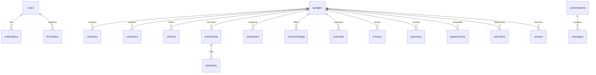

# DATABASE_DOCUMENTATION.md — Multi-Tenant Firestore Schema & Security Reference

## 1. Multi-Tenant Database Architecture Overview
The **Garage Card (WeFix)** platform utilizes **Google Cloud Firestore** configured as a secure, multi-tenant document database.
The data architecture relies on a **Hierarchical Tenant Subcollection Pattern** anchored under `garages/{garageId}/*`, combined with dedicated user identity collections (`users/{uid}`) and shared communication rooms (`conversations/{convId}`).

---

## 2. Collection Schemas & Field Mappings

### 2.1 Top-Level Collections

#### A. `users/{userId}`
Stores the core profile and authentication record for every customer and garage staff member.
- `uid`: `String` (Firebase Auth UID)
- `email`: `String`
- `fullName`: `String`
- `phoneNumber`: `String` (E.164 format, e.g. `+919876543210`)
- `role`: `String` (`customer` | `merchant` | `admin`)
- `garageId`: `String?` (Required if `role == 'merchant'`)
- `avatarUrl`: `String?` (Firebase Storage download URL)
- `fcmTokens`: `List<String>` (Up to 4 active device push tokens)
- `createdAt`: `ISO8601 String` / `Timestamp`

*Subcollection:* `users/{userId}/notifications/{notificationId}`
- `id`: `String`
- `recipientUid`: `String`
- `title`: `String`
- `body`: `String`
- `subtitle`: `String?`
- `type`: `String` (`inquiry` | `job_status` | `estimate_decision` | `invoice_issued`)
- `deepLink`: `String?` (e.g. `/chat/{id}`, `/customer/invoices`)
- `garageId`: `String?`
- `isRead`: `Boolean` (Default `false`)
- `data`: `Map<String, dynamic>`
- `createdAt`: `ISO8601 String`

---

#### B. `garages/{garageId}`
Root document for each automotive workshop tenant.
- `id`: `String`
- `name`: `String`
- `ownerUid`: `String` (Firebase Auth UID of the primary owner)
- `phone`: `String`
- `whatsappNumber`: `String?`
- `email`: `String`
- `address`: `String`
- `city`: `String`
- `latitude`: `Double`
- `longitude`: `Double`
- `logoUrl`: `String?`
- `coverImageUrl`: `String?`
- `currencyCode`: `String` (Default `INR`)
- `rating`: `Double` (Aggregate score, e.g. `4.8`)
- `reviewCount`: `Integer`
- `openHours`: `String` (e.g. `9:00 AM - 7:00 PM`)
- `taxNumber`: `String` (GSTIN / VAT ID)
- `servicesOffered`: `List<String>`
- `supportedVehicleCategories`: `List<String>` (`car`, `motorcycle`, `scooter`)
- `isDoorstepRepairAvailable`: `Boolean`
- `isRoadsideAssistanceAvailable`: `Boolean`
- `isVerified`: `Boolean`
- `createdAt`: `ISO8601 String`

---

#### C. `conversations/{conversationId}`
Direct communication thread between a Customer and a Garage.
- `id`: `String` (`${customerId}_${garageId}` or UUID)
- `customerId`: `String`
- `customerName`: `String`
- `customerPhone`: `String?`
- `garageId`: `String`
- `garageName`: `String`
- `garagePhone`: `String?`
- `serviceJobTitle`: `String?`
- `participants`: `List<String>` (`[customerId, garageOwnerUid]`)
- `lastMessage`: `String`
- `lastMessageTime`: `ISO8601 String`
- `lastSenderId`: `String`
- `unreadCountCustomer`: `Integer`
- `unreadCountMerchant`: `Integer`
- `createdAt`: `ISO8601 String`

*Subcollection:* `conversations/{conversationId}/messages/{messageId}`
- `id`: `String`
- `conversationId`: `String`
- `senderId`: `String`
- `senderRole`: `String` (`customer` | `merchant`)
- `text`: `String`
- `isRead`: `Boolean`
- `createdAt`: `ISO8601 String`

---

### 2.2 Garage Tenant Subcollections (`garages/{garageId}/*`)

#### A. `serviceJobs/{jobId}`
Represents an active or historical vehicle repair job card.
- `id`: `String`
- `garageId`: `String`
- `jobCardNumber`: `String` (e.g. `JC-2026-0042`)
- `customerId`: `String`
- `customerName`: `String`
- `customerPhone`: `String`
- `vehicleId`: `String`
- `vehicleRegistrationNumber`: `String` (e.g. `KL-07-CD-5678`)
- `vehicleMake`: `String`
- `vehicleModel`: `String`
- `vehicleYear`: `Integer`
- `currentOdometer`: `Integer` (in kilometers or miles)
- `customerReportedIssues`: `String`
- `serviceType`: `String` (`periodicService` | `mechanicalRepair` | `bodywork` | `diagnostic`)
- `status`: `String` (`draft` | `received` | `inspectionPending` | `estimatePending` | `estimateApproved` | `inProgress` | `readyForCollection` | `completed` | `closed` | `rejected`)
- `assignedMechanicId`: `String?`
- `assignedMechanicName`: `String?`
- `coverPhotoUrl`: `String?`
- `createdDate`: `ISO8601 String`
- `estimatedCompletionDate`: `ISO8601 String?`
- `completedDate`: `ISO8601 String?`
- `serviceCharges`: `Double`

*Subcollection:* `serviceJobs/{jobId}/history/{historyId}`
- `id`: `String`
- `jobId`: `String`
- `previousStatus`: `String`
- `newStatus`: `String`
- `changedByUid`: `String`
- `notes`: `String?`
- `timestamp`: `ISO8601 String`

---

#### B. `estimates/{estimateId}`
Itemized cost breakdown prepared for customer review and approval.
- `id`: `String`
- `garageId`: `String`
- `jobId`: `String`
- `estimateNumber`: `String` (e.g. `EST-0089`)
- `customerId`: `String`
- `customerName`: `String`
- `vehicleRegistrationNumber`: `String`
- `vehicleModel`: `String`
- `lineItems`: `List<Map>`:
  - `description`: `String`
  - `type`: `String` (`part` | `labor`)
  - `quantity`: `Double`
  - `unitPrice`: `Double`
  - `totalPrice`: `Double`
- `subtotal`: `Double`
- `taxAmount`: `Double`
- `discountAmount`: `Double`
- `totalAmount`: `Double`
- `status`: `String` (`draft` | `sent` | `approved` | `rejected`)
- `rejectionReason`: `String?`
- `approvedAt`: `ISO8601 String?`
- `createdAt`: `ISO8601 String`

---

#### C. `invoices/{invoiceId}`
Finalized billing document generated from an approved estimate or repair job.
- `id`: `String`
- `garageId`: `String`
- `jobId`: `String`
- `estimateId`: `String?`
- `invoiceNumber`: `String` (e.g. `INV-2026-0104`)
- `customerId`: `String`
- `customerName`: `String`
- `vehicleRegistrationNumber`: `String`
- `vehicleModel`: `String`
- `lineItems`: `List<Map>` (Identical structure to estimate line items)
- `subtotal`: `Double`
- `taxRate`: `Double`
- `taxAmount`: `Double`
- `discountAmount`: `Double`
- `totalAmount`: `Double`
- `amountPaid`: `Double`
- `balanceDue`: `Double`
- `status`: `String` (`unpaid` | `partiallyPaid` | `paid` | `cancelled`)
- `pdfUrl`: `String?`
- `dueDate`: `ISO8601 String`
- `issuedAt`: `ISO8601 String`

---

#### D. `payments/{paymentId}`
Ledger records of payments made toward specific invoices.
- `id`: `String`
- `garageId`: `String`
- `invoiceId`: `String`
- `customerId`: `String`
- `amount`: `Double`
- `paymentMethod`: `String` (`cash` | `upi` | `card` | `bankTransfer`)
- `transactionReference`: `String?`
- `paymentDate`: `ISO8601 String`
- `receivedByUid`: `String`

---

#### E. `serviceCatalog/{serviceId}`
Workshop service and package offerings with dynamic pricing rules.
- `id`: `String`
- `garageId`: `String`
- `name`: `String`
- `description`: `String`
- `category`: `String` (`Periodic Service` | `Brakes` | `Engine` | `Wash & Detail` | `AC Service`)
- `imageUrl`: `String?`
- `pricingMethod`: `String` (`fixed` | `startingAt` | `categoryBased` | `quotationRequired`)
- `fixedPrice`: `Double?`
- `startingPrice`: `Double?`
- `categoryPrices`: `Map<String, Double>` (e.g. `{'hatchback': 1999, 'sedan': 2499, 'suv': 2999}`)
- `attributeRules`: `List<Map>` (Engine CC / segment rules)
- `estimatedDuration`: `String` (e.g. `2-3 hrs`)
- `terms`: `String?` (What is included / parts warranty)
- `isActive`: `Boolean`

---

#### F. `reviews/{reviewId}`
Customer ratings and reviews left after job completion.
- `id`: `String`
- `garageId`: `String`
- `jobId`: `String?`
- `customerId`: `String`
- `customerName`: `String`
- `customerAvatarUrl`: `String?`
- `rating`: `Double` (1.0 to 5.0)
- `comment`: `String`
- `createdAt`: `ISO8601 String`

---

## 3. Security Rules & Boundary Enforcement Summary

1. **Authentication Requirement:**
   - Every read and write to private customer/garage documents strictly requires `request.auth != null`.
2. **Tenant Scoping:**
   - Writes to `garages/{garageId}/*` verify that `request.auth.uid` is either the garage's registered `ownerUid` or exists within `garages/{garageId}/members/{uid}`.
3. **Customer Isolation:**
   - Reads to `serviceJobs`, `estimates`, `invoices`, and `appointments` enforce `resource.data.customerId == request.auth.uid` or membership in the owning garage.
4. **Restricted Customer Updates:**
   - On `estimates/{estimateId}`, customers can ONLY update `status`, `rejectionReason`, and `approvedAt`. They cannot tamper with `subtotal`, `taxAmount`, or `totalAmount`.
5. **Storage Security:**
   - Images are validated before upload: `request.resource.size < 5 * 1024 * 1024` and `request.resource.contentType.matches('image/.*')`.

