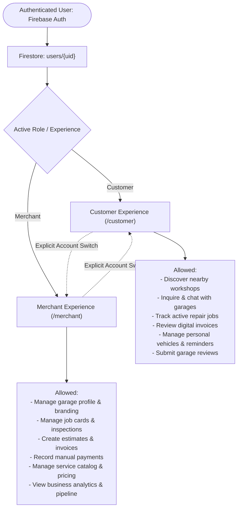
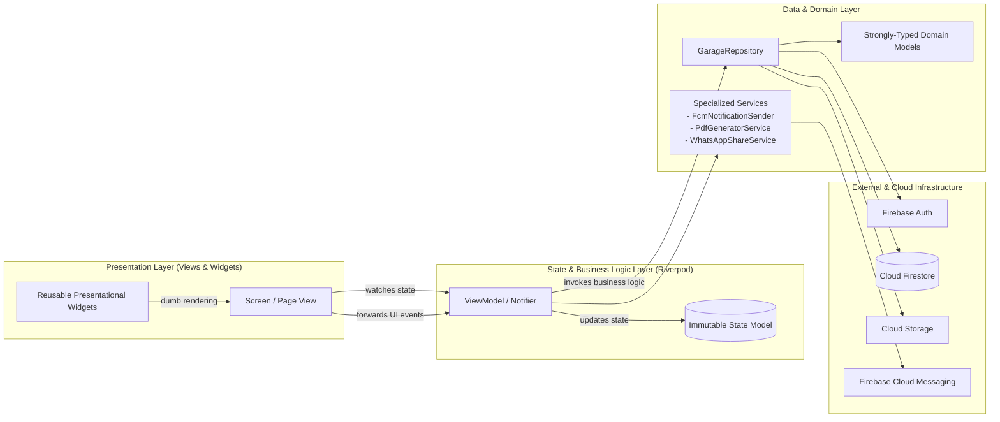
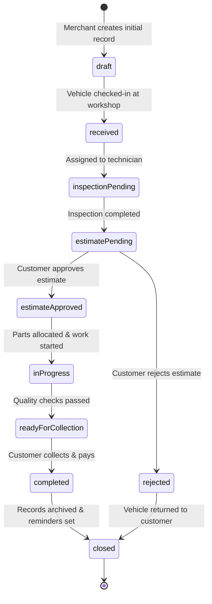
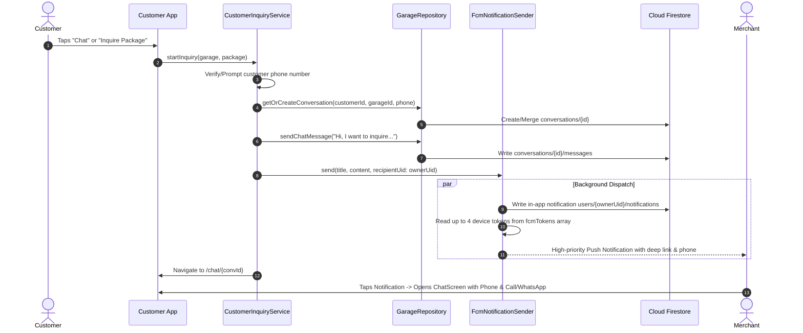

# PROJECT_CONTEXT.md — Comprehensive Project Context & System Documentation

## 1. Project Overview

### 1.1 Project Identity
- **Project Name:** Garage Card (Commercial Brand: **WeFix**)
- **Brand Slogan:** *WeFix – Smarter Garage Management. Better Vehicle Care.*
- **Platform Application:** Multi-Tenant Automotive Service & Garage Management Platform
- **Form Factors:** Mobile (Android/iOS), Tablet, Laptop, and Web (Desktop / Mobile Browsers)
- **Codebase Strategy:** Unified single Flutter codebase supporting dual distinct experiences (Customer & Merchant) with multi-device responsive adaptations.

### 1.2 Main Business Purpose
The automotive aftermarket repair and maintenance industry is plagued by fragmented communication, opaque pricing, physical paperwork, unorganized job tracking, and lost customer retention. Garage Card bridges vehicle owners (Customers) and independent automotive workshops (Merchants) into a synchronized digital ecosystem.

### 1.3 Problems It Solves
1. **For Vehicle Owners (Customers):**
   - Eliminates uncertainty regarding repair status, hidden charges, and unexpected supplementary work.
   - Replaces physical paper bills with tamper-proof digital invoices and immutable service histories.
   - Provides transparent garage discovery with geo-located proximity, verified reviews, and fixed-price service packages.
   - Automates routine maintenance tracking with smart predictive service reminders.
2. **For Independent Garages (Merchants):**
   - Eliminates manual whiteboard/paper job card tracking, reducing lost billing and unapproved labor charges.
   - Simplifies customer communication through automated in-app alerts, WhatsApp pre-filled dispatches, and push notifications.
   - Streamlines digital estimates with one-tap WhatsApp sharing and instant customer approval tracking.
   - Provides clear financial oversight: daily pipeline tracking, outstanding accounts receivable, daily operations to-dos, and profit/loss analytics.

### 1.4 Target Audience
- **Primary Consumers:** Two-wheeler (motorcycle/scooter) and four-wheeler (car/SUV) vehicle owners seeking trusted, transparent workshop care.
- **Primary Business Users:** Independent garage owners, service center managers, service advisors, and lead mechanics running commercial workshops.

### 1.5 Business Model & Value Proposition
- **SaaS Subscription Tiers:** Free, Basic, Pro, and Enterprise monthly/annual plans for garages with limits on active jobs, staff seats, and advanced analytics.
- **Lead Generation & Market Discovery:** Garages list transparent periodic maintenance packages to attract nearby motorists.
- **Value Proposition:** *"Zero opaque pricing for customers, zero unbilled labor for mechanics, and complete operational transparency from check-in to collection."*

---

## 2. User Roles & Access Control

### 2.1 Customer Role
- **Identity:** Individuals who own one or more vehicles and bring them to garages for inspection, maintenance, or collision repair.
- **Access Boundary:**
  - Reads public garage profiles, service catalogs, and approved customer reviews.
  - Reads and writes personal user profile data (`users/{uid}`).
  - Reads active and completed service jobs matching `customerId == request.auth.uid`.
  - Reads digital invoices and payment receipts matching their customer ID.
  - Submits inquiries and service booking requests to garages.
  - Participates in two-way instant messaging with assigned garages (`conversations/{convId}`).
- **Restrictions:** Strict zero-access to merchant dashboards, other customers' records, repair cost calculations, employee rosters, or financial analytics.

### 2.2 Merchant / Garage Owner Role
- **Identity:** Garage owners, service managers, or authorized staff operating a registered automotive repair facility.
- **Access Boundary:**
  - Full CRUD authority over their designated garage tenant (`garages/{garageId}/*`).
  - Creation and management of customer profiles (`garages/{garageId}/customers`).
  - Creation, status management, and mechanic assignment for service jobs (`garages/{garageId}/serviceJobs`).
  - Digital inspection checkups with photo uploads (`garages/{garageId}/inspections`).
  - Drafting and issuing itemized estimates (`garages/{garageId}/estimates`).
  - Issuing invoices and logging offline/cash/UPI payments (`garages/{garageId}/invoices` & `payments`).
  - Configuring workshop catalog, pricing engine rules, and operating hours.
  - Viewing real-time daily pipelines, revenue charts, and operational to-do lists.
- **Restrictions:** Cannot read or modify records belonging to other garage tenants.

### 2.3 Administrator Role (Platform Oversight)
- **Identity:** Internal system operations and support team.
- **Capabilities:** Platform analytics, garage verification review, subscription management, security audit logging, and global catalog curation.

### 2.4 Account Switching Mechanism
- Users can hold both customer and merchant identities under a single Firebase Auth UID.
- Switching is non-automatic and explicit: located inside the **Profile** section of both experiences.
- Upon user confirmation, `AuthViewModel.switchExperience(...)` updates `activeExperience` in Riverpod state, persists the session to `SharedPreferences`, and safely redirects the user through `GoRouter`.

---

## 3. Technology Stack & Dependencies

| Layer | Technology | Specification / Package |
|---|---|---|
| **Frontend Framework** | Flutter SDK | Dart `^3.13.5`, Flutter 3.x, Null Safety enforced |
| **State Management** | Riverpod | `flutter_riverpod: ^3.4.3` (`Notifier`, `AsyncNotifier`, `ProviderScope`) |
| **Routing** | GoRouter | `go_router: ^18.1.1` (Declarative, auth listenable, URL query params) |
| **Backend Infrastructure**| Firebase Serverless | Firebase Auth, Cloud Firestore, Cloud Storage, Cloud Functions v2 |
| **Push & In-App Alerts** | Firebase Messaging | `firebase_messaging: ^17.0.1`, `flutter_local_notifications: ^22.3.2`, Custom pure-Flutter `FcmNotificationSender` |
| **Document Generation** | PDF & Printing | `pdf: ^3.13.1`, `printing: ^5.15.1` (High-fidelity vector invoices & estimates) |
| **Localization** | Flutter Localizations | `flutter_localizations`, `intl: ^0.20.3` (English `en`, Malayalam `ml`) |
| **Location & Spatial** | Geolocation & Geohash | Custom `GeohashHelper` (Haversine bounding box & distance calculation) |
| **Network & Connectivity**| Connectivity Plus | `connectivity_plus: ^7.3.2`, Custom `ConnectivityService` |
| **UI Design System** | Automotive Luxury System | Custom `AppColors`, Google Fonts, Phosphor Icons, Material Icons, SVG |

---

## 4. Complete Feature Inventory & Current Status

| Feature Module | User Role | Frontend Implementation | Backend Implementation | Firestore Collections / APIs | Current Status |
|---|---|---|---|---|---|
| **Splash & Branding** | Public | `SplashScreen`, `AppLogo`, `AppBranding` | Session cache check in `SharedPreferences` | Local device storage | **Fully Implemented** |
| **Authentication & Role Selection** | Customer & Merchant | `AuthScreen`, `AuthRoleSelector` | Firebase Auth (Email/Pass, Google Sign-In) | `users/{uid}` | **Fully Implemented** |
| **Account Switching** | Customer & Merchant | `AccountSwitcherListView`, Profile screens | Session role persistence & router redirection | `users/{uid}.role` | **Fully Implemented** |
| **Nearby Garages Discovery** | Customer | `NearbyGaragesScreen` (Responsive Grid) | Spatial distance bounding via `GeohashHelper` | `garages` | **Fully Implemented** |
| **Garage Details & Packages** | Customer | `CustomerGarageDetailScreen` | Real-time stream of catalog & reviews | `garages/{id}/serviceCatalog`, `reviews` | **Fully Implemented** |
| **Customer Active Job Tracker** | Customer | `CustomerDashboardScreen`, `CustomerJobDetailScreen` | Status timeline, mechanic details, photo gallery | `garages/{gId}/serviceJobs/{jId}` | **Fully Implemented** |
| **Customer Invoices** | Customer | `CustomerInvoicesScreen` (Responsive Tabs) | Fetch invoices & payments matching `customerId` | `garages/{gId}/invoices` | **Fully Implemented** |
| **Customer Vehicles** | Customer | `CustomerVehiclesScreen`, `VehicleCardItem` | Customer vehicle query (redirects to garages flow) | `garages/{gId}/vehicles` | **Fully Implemented** |
| **Instant OLX-Style Chat** | Customer & Merchant | `ConversationListScreen`, `ChatScreen` | Firestore conversation & message streams | `conversations/{id}/messages` | **Fully Implemented** |
| **FCM Push & In-App Alerts** | Customer & Merchant | `FcmNotificationSender`, Notification centers | Cloud Functions v2 triggers + Client HTTP dispatch | `users/{uid}/notifications`, `fcmTokens` | **Fully Implemented** |
| **Merchant Dashboard & Pipeline**| Merchant | `MerchantDashboardScreen` (84px metric cards) | Aggregated queries for due jobs & completed counts | `garages/{gId}/serviceJobs` | **Fully Implemented** |
| **Merchant Job Management** | Merchant | `MerchantJobsScreen`, `MerchantJobDetailScreen` | Job status dialogs, mechanic assignment | `garages/{gId}/serviceJobs` | **Fully Implemented** |
| **Digital Vehicle Inspections** | Merchant | `VehicleInspectionModel`, photo checklist | Firestore inspection documents with media links | `garages/{gId}/inspections` | **Fully Implemented** |
| **Estimates & WhatsApp Dispatch**| Merchant | `MerchantEstimatesScreen`, `EstimateFormDialog` | PDF vector builder, pre-filled WhatsApp links | `garages/{gId}/estimates` | **Fully Implemented** |
| **Invoicing & Payment Logging** | Merchant | `MerchantInvoicesScreen`, `RecordPaymentDialog` | Invoice lock snapshot, balance deduction | `garages/{gId}/invoices`, `payments` | **Fully Implemented** |
| **Service Catalog & Pricing Engine**| Merchant | `MerchantServicesScreen`, `ServiceEditDialog` | `SmartPricingEngine` rule evaluation | `garages/{gId}/serviceCatalog` | **Fully Implemented** |
| **Customer Management CRM** | Merchant | `MerchantCustomersScreen`, `MerchantCustomerCard`| Customer directory with vehicle associations | `garages/{gId}/customers` | **Fully Implemented** |
| **Merchant Analytics & P&L** | Merchant | `MerchantAnalyticsScreen`, `ProfitLossCard` | `FinancialMetricsModel`, daily operations to-dos | Aggregated invoice & job calculations | **Fully Implemented** |
| **Garage Profile & Hours** | Merchant | `GarageProfileScreen`, `GarageHoursEditor` | Garage document updates & logo storage upload | `garages/{garageId}` | **Fully Implemented** |
| **Smart Service Reminders** | Customer & Merchant | `CustomerRemindersScreen`, `ReminderCardItem` | Service interval calculation based on odometer | `garages/{gId}/reminders` | **Fully Implemented** |
| **Appointment Booking** | Customer & Merchant | `CustomerAppointmentsScreen` modal sheet | Appointment creation and status progression | `garages/{gId}/appointments` | **Fully Implemented** |
| **Offline Mode & Banner** | Global | `AppConnectivityWrapper`, `NoInternetScreen` | `connectivity_plus` stream monitoring | Device hardware connection | **Fully Implemented** |

---

## 5. Architectural Blueprints & Data Flow

### 5.1 Layered MVVM Architecture

### 5.2 Repair Job State Machine
A repair job progresses strictly through sequential statuses:

### 5.3 Instant Inquiry & Notification Flow

### 5.4 Dynamic Service Management & Multi-Vehicle Pricing Engine
Workshops can independently configure and customize their services catalog under `garages/{garageId}/services/{serviceId}`:
- **Multi-Vehicle Compatibility:** Services declare supported vehicle types (`car`, `motorcycle`, `scooter`, `electric_scooter`, `electric_motorcycle`, `other`).
- **Flexible Pricing Structures:**
  1. `fixed`: Flat rate regardless of vehicle type.
  2. `range`: Min and max price limits.
  3. `vehicle_specific`: Granular tiers (`List<VehiclePricingTier>`) configured per vehicle class with independent fixed or range pricing.
  4. `contact`: Custom quotation workflow for complex diagnostic or overhaul procedures.
- **Smart Dynamic Resolution:** `SmartPricingEngine.evaluate` parses client context (selected vehicle type, engine displacement, vehicle attributes) to provide instant deterministic pricing.

### 5.5 Advanced Proximity & Vehicle-Specific Discovery Search (`/customer/search`)
Customers discover workshop services via a dedicated, auto-focused search screen:
- **Cross-Entity Matching:** Searches across garage names, locations, service titles, descriptions, and categories simultaneously.
- **Interactive Multi-Filter Drawer:**
  - Distance radius: < 2km, < 5km, < 10km, < 25km.
  - Vehicle compatibility filter: e.g. Scooters, Cars, EV Scooters.
  - Service categories: Periodic Service, Wash & Detailing, Mechanical, Diagnostics, Electrical.
  - Price budget filter: Evaluates vehicle-specific pricing dynamically (e.g. ₹250–₹450 scooter oil change fits under ₹500 budget while ₹1,500 car oil change is filtered out).
  - Sorting: Nearest first, Price low-to-high, Price high-to-low, Highest rated.
- **Responsive Layout:** Automatically adapts between 1-column mobile layouts and centered max-width 860px desktop presentation with zero overflows down to 320px width.

### 5.6 Zero-Cost Geocoding & Open Maps Integration (No Google Maps API)
Merchants configure their workshop location without paid Google Maps API keys:
- **URL Coordinate Extraction:** Automatically parses latitude and longitude from Google Maps share links using regex patterns (`@lat,lng` and `?q=lat,lng`).
- **Open Geocoding:** Resolves text addresses using the free OpenStreetMap Nominatim forward geocoding API.

### 5.7 Real-Time Repair Tracking, Start Repair & Complete Repair Workflows
Repairs progress through verified operational states backed by actual Firestore records:
- **Active Repair Qualification:** A repair job qualifies as `isActiveRepair` strictly when work has commenced (`in_progress`, `awaiting_parts`, `on_hold`, `quality_check`). Requests, bookings, or estimates awaiting decision are explicitly classified as `isPendingRequest` and excluded from active repairs.
- **Merchant "Start Repair" Action:** Explicit action requiring lead technician assignment and commencement notes; transitions status to `in_progress`, logs `actualStartTime`, writes customer-visible history, and triggers high-priority customer notification with deep link `/customer/jobs/{jobId}`.
- **Merchant "Complete Repair" Action:** Final handover dialog capturing final odometer reading, target odometer, next recommended service type and due date, and handover notes. Atomically:
  1. Transitions job to `completed` and records `completedDate`.
  2. Generates/updates vehicle record with `currentOdometer`, `lastServiceDate`, `lastServiceType`, `nextServiceDue`, and `nextServiceOdometer`.
  3. Automatically schedules a `ServiceReminderModel` for the vehicle.
  4. Issues a 6-digit cryptographic digital gate pass OTP.
  5. Emits `'Service Completed'` push notification with OTP and review prompt.

### 5.8 Dynamic Upcoming Vehicle Maintenance & History Privacy
- **Maintenance Intelligence:** Computed directly from vehicle records and completed repair jobs:
  - `upcoming`: Due in > 14 days and > 500 km remaining.
  - `due_soon`: Due within 14 days or <= 500 km remaining.
  - `due`: Due within 3 days or <= 100 km remaining.
  - `overdue`: Date in past or current odometer exceeds target.
  - `not_available`: Rendered authentically when no vehicle maintenance schedule exists (zero fake or simulated dates).
- **History Privacy & Audit Trail:** History logs record `isCustomerVisible`. Internal mechanic diagnostic notes remain strictly private to merchants, while customer timelines only show customer-approved milestones.
- **Direct Navigation:** "Test Location on Maps" and customer navigation buttons launch external Google Maps search queries via standard `url_launcher`.

### 5.7 Mandatory Global UI States, Loading, Skeleton, Empty & Error Architecture
The platform enforces a unified suite of reusable state components across Customer, Merchant, and Admin surfaces (`lib/core/shared_widgets/`):
- **`AppLoadingState` & `AppSkeletonLoader`:** Progressive loading with shimmer animation (card, list, grid, profile, line, circle) maintaining layout structure without abrupt layout shifts.
- **`AppEmptyState`:** Role-specific, contextual empty states with actionable next steps (e.g. "You haven't registered a garage yet" -> "Add Your Garage"; "No repair jobs found" -> "Create New Job"; "You haven't added any services yet" -> "Add Service"). Zero fake/local dummy fallback records.
- **`AppSearchEmptyState`:** Dedicated search-not-found state displaying user query, spelling suggestions, and clear-filter actions, strictly decoupled from backend error handling.
- **`AppErrorState` & `AppRetryButton`:** Error presentation categorizing server, network, timeout, validation, and permission failures, with retry debouncing and technical debug detail expansion without leaking raw stack traces.
- **`AppOfflineState`:** Distinguishes live vs cached data with last-sync timestamps and offline cached indicators.
- **`AppPermissionState` & `AppUnauthorizedState`:** Contextual explanations for location, notifications, camera, storage, and session expirations.
- **`AppLoadingOverlay`:** Non-blocking visual feedback during network mutations preventing duplicate form and action submissions.

### 5.8 Dynamic Application-Wide Multi-Language Localization (English & Malayalam)
The application incorporates a dynamic bilingual localization architecture supporting English (`en`) and Malayalam (`ml`):
- **Dynamic Runtime Switching:** Reactive Riverpod `localeProvider` controls `MaterialApp.router`'s `locale`, dynamically rebuilding the UI upon language selection without application restarts.
- **Phrase-to-Key Universal Fallback (`_phraseToKeyMap`):** Bridges raw UI English phrases directly to normalized localization keys, translating screens, buttons, app bars, and dialogs seamlessly.
- **Status Code Translation Engine:** Translates normalized backend status codes (`in_progress`, `completed`, `received`, `waiting_for_parts`, `ready_for_collection`, `paid`, `unpaid`, `overdue`, `due_soon`) into natural localized labels via `loc.status(rawStatus)`, `loc.repairStatus(rawStatus)`, and `loc.invoiceStatus(rawStatus)`.
- **Strict Business Data Preservation:** User-generated and database-stored business records (garage names, customer names, registration numbers, notes, custom services) are never altered or translated.
- **Automotive Typography & Zero-Overflow Layouts:** Leverages Malayalam font fallbacks (`Manjari`, `Gayathri`, `Noto Sans Malayalam`) maintaining zero `RenderFlex` overflows across all device form factors down to 320px.

### 5.9 Customer–Merchant Support & Ticket Management System (`/customer/support`, `/merchant/support`)
The application features a production-ready, multi-tenant bidirectional ticketing architecture:
- **Customer Ticketing:** Customers raise structured support tickets linked to their vehicles, garages, repair jobs, and invoices with categories (`vehicle_issue`, `repair_delay`, `estimate_inquiry`, `invoice_dispute`, `service_quality`, `general_support`), priority levels, contact preferences, and attachments.
- **Merchant Helpdesk & Operational KPIs:** Garage staff manage inbound tickets via dedicated dashboard metrics (Total, Open, In Progress, Waiting Customer, Waiting Merchant, Resolved, Closed) and filter by priority, category, and garage.
- **Staff-Only Internal Notes:** Merchants can publish private internal notes (`isInternal: true`) that are strictly invisible to customers and cryptographically blocked at the Firestore Security Rules layer.
- **Audit Trails & Real-Time Messaging:** Every ticket maintains an immutable timeline history (`history/{id}`) and real-time message stream (`messages/{id}`) with automated customer and merchant notifications.
- **Lifecycle Management:** Tickets transition through `open`, `assigned`, `in_progress`, `waiting_for_customer`, `waiting_for_merchant`, `resolved`, `closed`, and `reopened`, supporting customer reopening and merchant resolution comments.

### 5.10 Centralized Image Compression, Optimization & Firebase Storage Pipeline
The platform includes an automated, visually lossless image optimization and storage infrastructure:
- **Centralized Engine (`ImageUploadService`):** Provides an unified API across all features to handle validation, EXIF orientation correction, metadata stripping, aspect-ratio downscaling, and compression before transmission to Firebase Storage.
- **Visual Losslessness & Smart Encoding:** `ImageCompressionProcessor` automatically detects transparency: images with transparent alpha channels are encoded as compressed PNGs (`level: 6`), while opaque photographs are compressed to high-efficiency JPEGs (`quality: 82–88`). EXIF rotation tags are permanently baked into raw pixel buffers via `bakeOrientation`.
- **Predefined Use-Case Profiles:** `ImageProfile.thumbnail` (300×300), `ImageProfile.card` (800×800), `ImageProfile.standard` (1200×1200), and `ImageProfile.large` (1920×1920) prevent arbitrary file uploads from wasting bandwidth and storage.
- **Safe Asset Lifecycle & Replacement:** Uploading replacements cleanly purges previous assets from Firebase Storage only after new uploads and Firestore document references succeed.
- **Frontend Memory Optimization:** `AppCachedImage` constraints memory cache (`memCacheWidth`, `memCacheHeight`), preventing raw bitmaps from exhausting device GPU memory. `AppImagePickerBox` provides unified picking, progress tracking, and removal micro-interactions.

### 5.11 WhatsApp Business Style Operating Hours & Daily Schedule System
The merchant profile includes an interactive, WhatsApp Business-style operating hours and schedule system:
- **Individual Day-by-Day Configuration:** Merchants select and toggle each day of the week individually (Monday through Sunday), configuring custom opening and closing times per day.
- **Structured Schedule Model (`DayWorkingHours` & `WorkingHoursSchedule`):** Stores structured daily schedules under `dailyWorkingHours` in `GarageModel` while atomically generating human-readable schedule summaries in `openHours` for backward compatibility.
- **Native Material Time Pickers:** Integrated 12-hour AM/PM time pickers allowing merchants to tap opens-at and closes-at chips for individual days.
- **Quick Schedule Presets & Batch Actions:** One-tap presets for "Mon - Sat", "Mon - Fri", "All 7 Days", and "24/7 Always Open", plus a "Copy to all" action copying any day's custom schedule to all other open days.
- **Real-Time Open/Closed Status:** Live operational intelligence evaluates whether the workshop is currently open right now based on day of week and current local time.
- **Customer Side Weekly Schedule Breakdown:** Customers can expand the operating hours section in the garage details screen to view the complete Monday–Sunday weekly schedule.

### 5.12 Multi-Tenant Cloud Firestore Schema Architecture & Tenant Isolation
The database utilizes a secure, multi-tenant hierarchical subcollection design anchored under `garages/{garageId}/*`:
- **Top-Level Identity Collections:**
  - `users/{uid}`: Authenticated profile, role (`customer` | `merchant` | `admin`), garage affiliation, and `fcmTokens` array (capped at 4).
  - `users/{uid}/notifications/{id}`: Private user push and in-app alerts.
  - `garages/{garageId}`: Public profile, location coordinates, business hours, services offered, and verified badge.
  - `conversations/{id}` & `conversations/{id}/messages/{msgId}`: Multi-party customer–merchant communication thread.
- **Tenant Subcollections (`garages/{garageId}/*`):**
  - `serviceJobs/{jobId}`: Digital repair job card, vehicle information, assigned technician, status machine, and audit history subcollection `history/{id}`.
  - `estimates/{estimateId}`: Line-itemized costs with customer approval transitions (`approved`, `rejected`).
  - `invoices/{invoiceId}`: Finalized billing documents, tax calculations, balance tracking, and PDF receipts.
  - `payments/{paymentId}`: Immutable payment ledger records.
  - `inventory/{itemId}`: Parts and fluids inventory with low-stock alerts and unit cost tracking.
  - `serviceCatalog/{serviceId}`: Dynamic service definitions with multi-vehicle pricing rules.
  - `reviews/{reviewId}`: Customer verified review scores and comments.
- **Security & Tenant Boundary:** Direct Firestore Security Rules enforce default-deny, garage member ownership (`request.auth.uid in get(...).data.memberUids`), and strict customer data partitioning (`customerId == request.auth.uid`).

### 5.13 Cross-Platform Flutter Map & GPS Location Architecture
The merchant address and workshop positioning system uses OpenStreetMap and cross-platform GPS:
- **Interactive OpenStreetMap (`flutter_map`):** `AppMapLocationPicker` allows merchants to pan, zoom, and tap to pin their exact workshop location.
- **Cross-Platform GPS Auto-Detection:** `LocationService.instance.getCurrentPosition()` seamlessly operates across **Web** (HTML5 Geolocation) and **Android** (native `ACCESS_FINE_LOCATION` with fallback accuracy).
- **Google Maps Share Link Tool:** Accepts external Google Maps links (e.g. `maps.app.goo.gl`, `@lat,lng`, `q=lat,lng`) inside the map picker to jump to exact coordinates without requiring paid Google Maps APIs.
- **Reverse Geocoding:** Reverse-geocodes pinned coordinates into structured street and city addresses via OpenStreetMap Nominatim.

---

## 6. Critical Business Rules & Invariants

1. **Strict Data Boundary Check:** A merchant can only view and modify documents inside their authorized `garages/{garageId}` namespace. A customer can only access jobs, invoices, and estimates explicitly tagged with `customerId == request.auth.uid`.
2. **Zero Hardcoded Data in Production:** All dashboard metrics, pipeline counts, garage names, vehicle lists, and invoices must be fetched dynamically from the user's authentic records. Fallback states must render meaningful empty states with clear calls-to-action.
3. **Cursor-Based List Pagination:** Unbounded collections (jobs, invoices, notifications, customers, reviews) must paginate via `.orderBy(...).limit(pageSize).startAfterDocument(cursor)` with pre-fetching triggered at 75% scroll threshold.
4. **Device Token Management:** User device tokens for push alerts are stored in an array (`fcmTokens`) on `users/{uid}`, capped at the most recent 4 active devices to prevent stale multicasts.
5. **Money & Accounting Precision:** All financial line items (labor charges, part costs, taxes, discounts) are computed with strict floating-point rounding or integer cents, snapshotted onto estimates and frozen upon invoice creation.
6. **Zero Code Comments in Application Dart Source:** Application source files under `lib/` and `test/` must remain completely free of code comments (`//`, `/*`, `///`). All documentation resides exclusively in Markdown documents.
7. **Global UI State Completeness:** Every data-driven screen and asynchronous mutation must explicitly handle loading, success, empty, search-not-found, error, offline, and permission states without leaving screens blank or indefinitely loading.

